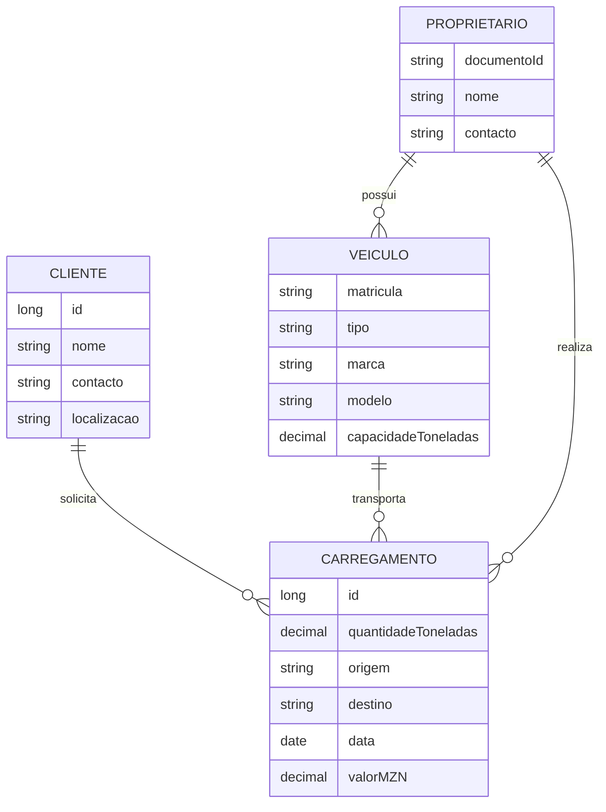
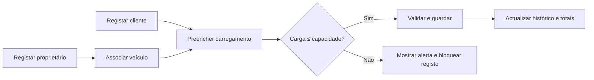
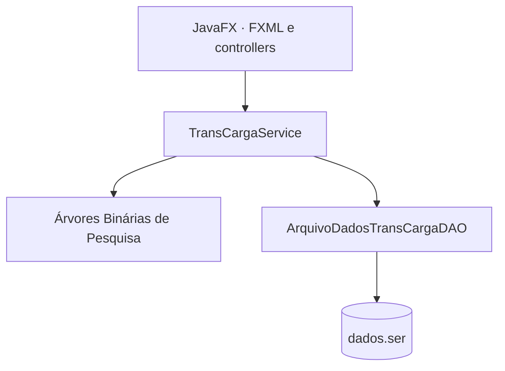

# 🚚 TransCarga Moçambique

> Aplicação desktop para gerir proprietários, frota, clientes e transportes, com os registos organizados em Árvores Binárias de Pesquisa (ABP).


<p align="center">
  <a href="#-funcionalidades">Funcionalidades</a> ·
  <a href="#-começar">Começar</a> ·
  <a href="#-como-usar">Como usar</a> ·
  <a href="#-estrutura-do-projecto">Estrutura</a> ·
  <a href="#-requisitos-cobertos">Requisitos</a>
</p>

<details>
<summary><strong>📚 Índice rápido</strong></summary>

- [Sobre o projecto](#-sobre-o-projecto)
- [Funcionalidades](#-funcionalidades)
- [Começar](#-começar)
- [Como usar](#-como-usar)
- [Regras de negócio](#-regras-de-negócio)
- [Estrutura do projecto](#-estrutura-do-projecto)
- [Persistência e localização dos dados](#-persistência-e-localização-dos-dados)
- [Requisitos cobertos](#-requisitos-cobertos)
- [Tecnologias](#-tecnologias)

</details>

## 🧭 Sobre o projecto

O TransCarga Moçambique digitaliza a gestão de uma empresa de transporte de mercadorias. A interface JavaFX permite registar e consultar os dados da operação; a camada de serviço valida as regras de negócio; e as árvores binárias mantêm os registos organizados.

### Modelo da operação



## ✨ Funcionalidades

<details open>
<summary><strong>👥 Proprietários e transportadores</strong></summary>

- Cadastrar nome, contacto e documento de identificação.
- Actualizar nome e contacto.
- Pesquisar por nome, contacto ou documento.
- Consultar quantos veículos pertencem a cada proprietário.
- Exportar a lista para CSV.

</details>

<details>
<summary><strong>🚛 Frota de veículos</strong></summary>

- Registar camiões e carrinhas de carga com matrícula, marca, modelo, capacidade e proprietário.
- Actualizar os dados do veículo e a associação ao proprietário.
- Consultar a receita por veículo.
- Filtrar camiões e carrinhas separadamente em capacidade crescente.
- Pesquisar por matrícula, marca ou modelo.

</details>

<details>
<summary><strong>🏢 Clientes</strong></summary>

- Cadastrar nome, contacto e localização.
- Actualizar os dados do cliente.
- Pesquisar nos clientes registados.
- Consultar indicadores de clientes, localidades e serviços.

</details>

<details>
<summary><strong>📦 Carregamentos e transportes</strong></summary>

- Registar cliente, veículo, quantidade, origem, destino, data e valor cobrado.
- Associar automaticamente o proprietário do veículo seleccionado.
- Mostrar o histórico com as informações principais de cada transporte.
- Filtrar os transportes pelo proprietário responsável.
- Pesquisar por cliente, matrícula, proprietário ou rota.
- Consultar totais de carga e receita.

</details>

## 🚀 Começar

### Pré-requisitos

- **JDK 25** (o `pom.xml` compila com `--release 25`).
- **Apache Maven 3.8+**.
- Ambiente gráfico compatível com JavaFX para abrir a aplicação.

O Maven descarrega as dependências JavaFX e MaterialFX declaradas no projecto.

### Executar

Na raiz do projecto:

```bash
mvn clean javafx:run
```

Este comando compila o código e inicia a interface. Também pode abrir o projecto no IDE e executar o objectivo Maven `javafx:run`.

### Compilar e validar

```bash
mvn clean package
mvn test
```

> O projecto ainda não inclui testes unitários automatizados; `mvn test` valida a fase de testes do Maven. Para iniciar a janela JavaFX, use `mvn javafx:run` num ambiente com display.

## 🖱️ Como usar

1. **Abra Proprietários** e registe cada transportador com um documento único.
2. **Abra Frota de Veículos** e registe os veículos, escolhendo o tipo e o proprietário.
3. Use os separadores **Apenas Camiões** ou **Apenas Carrinhas** para consultar cada tipo em capacidade crescente.
4. **Abra Clientes** e registe quem solicita os transportes.
5. **Abra Carregamentos & Transportes**, escolha o cliente e o veículo e preencha os dados da carga e da rota.
6. Consulte o histórico ou seleccione um proprietário no filtro para ver apenas os serviços da sua frota.
7. Na tabela da frota, use **Receita** para consultar o total e os serviços de um veículo.

### Exemplo de validação

Se a capacidade registada de uma carrinha for **2 toneladas**, uma carga de **1,5 toneladas** pode ser guardada. Ao introduzir **3 toneladas**, a aplicação mostra o aviso de capacidade e desactiva o botão de registo. A mesma regra é aplicada novamente no serviço, pelo que a validação não depende apenas da interface.

## ⚖️ Regras de negócio

- Um proprietário pode possuir vários veículos; cada veículo fica ligado a um proprietário.
- Matrícula identifica o veículo e não pode ser alterada na edição.
- A capacidade do veículo tem de ser positiva.
- A quantidade transportada tem de ser positiva e não pode ultrapassar a capacidade do veículo.
- Não é possível reduzir a capacidade de um veículo para um valor inferior a uma carga já registada para esse veículo.
- O valor cobrado não pode ser negativo.
- Os dados obrigatórios são validados antes de serem guardados.

### Percurso da operação



## 🌳 ABP e ordenação

Os veículos estão guardados numa ABP cuja chave é a capacidade de carga, com a matrícula como critério secundário para capacidades iguais. A listagem em ordem simétrica percorre `esquerda → raiz → direita`; ao filtrar por tipo, a ordem crescente é preservada.

```text
                  5 t
                 /   \
               2 t   12 t

Percurso em ordem: 2 t → 5 t → 12 t
```

Assim, os filtros de camiões e carrinhas apresentam cada tipo em capacidade crescente.

## 🗂️ Estrutura do projecto

```text
src/
├── controller/       # Controladores JavaFX e ligação às vistas
├── model/            # Entidades, ABP e dados da aplicação
├── persistence/      # Leitura e escrita do ficheiro de objectos
├── service/          # Regras de negócio e operações do sistema
└── view/
    ├── css/          # Estilos da interface
    └── fxml/         # Ecrãs JavaFX
```

### Camadas da aplicação



## 💾 Persistência e localização dos dados

Os registos são serializados num ficheiro de objectos, guardado fora do projecto no directório do utilizador:

| Sistema | Caminho |
|---|---|
| Linux / macOS | `~/.transplus/dados.ser` |
| Windows | `%USERPROFILE%\.transplus\dados.ser` |

O directório é criado automaticamente na primeira gravação. Para iniciar uma base vazia, feche a aplicação e remova **apenas** o ficheiro `dados.ser`; esta operação apaga os registos guardados.

## ✅ Requisitos cobertos

| Requisito | Funcionalidade |
|---|---|
| Cadastro e actualização de proprietários | Formulário e tabela de proprietários |
| Cadastro, associação e actualização de veículos | Frota com proprietário obrigatório |
| Listagem por tipo e capacidade crescente | Filtros de camiões e carrinhas sobre percurso em ordem da ABP |
| Cadastro e actualização de clientes | Formulário e tabela de clientes |
| Registo e consulta de transportes | Histórico com cliente, veículo, proprietário, carga, rota, data e valor |
| Validação da capacidade | Alerta em tempo real e validação no serviço |
| Transportes por proprietário | Filtro de histórico por proprietário |
| Receita por veículo | Consulta de receita acumulada e lista de serviços |
| Persistência em ficheiro de objectos | Serialização de `DadosTransCarga` |

## 🧰 Tecnologias

- Java 25
- JavaFX 25 (Controls e FXML)
- MaterialFX
- Apache Maven
- Serialização de objectos Java
- Árvores Binárias de Pesquisa
- Markdown do GitHub, com blocos expansíveis, Mermaid e navegação por secções

---

<p align="center">
  <strong>TransCarga Moçambique</strong> · Gestão simples para uma operação em movimento.
</p>
